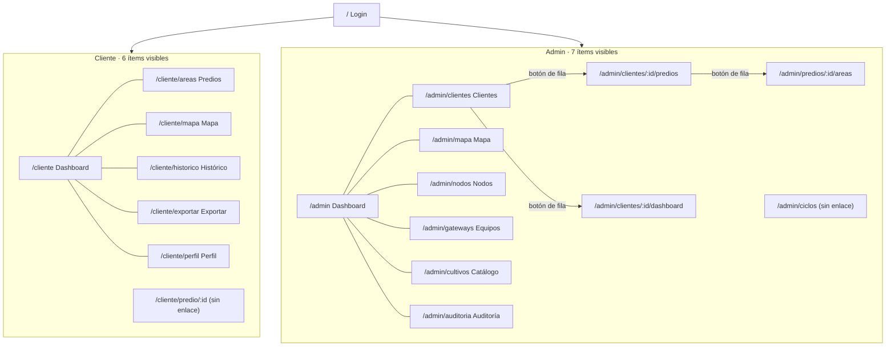
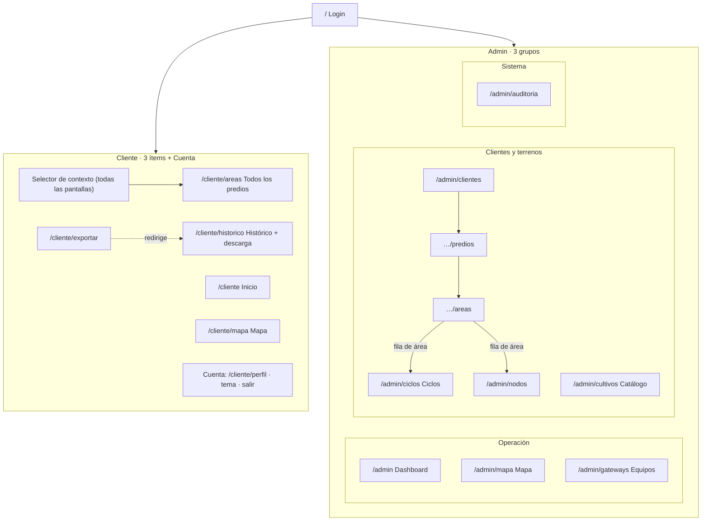

# Arquitectura de navegación

Alcance: solo módulos activos en el MVP. Las rutas de Fase 2 no cambian, conservan su gate de menú y aparecen aquí solo para marcar que quedan intactas.

## 1. Estructura actual

Problemas que resuelve la propuesta: N1 (ítems ocultos en móvil), N2 y N4 (rutas sin entrada), N3 (jerarquía solo por botones de fila), N5 (dos rutas de alta de nodos), N6 (contexto repetido), F1 (exportar duplicado).

## 2. Estructura propuesta

### Cliente

| Antes | Después | Motivo |
|---|---|---|
| Menú: Dashboard, Predios, Mapa, Histórico, Exportar, Perfil (6) | Menú: **Inicio, Histórico, Mapa** (3) + **Cuenta** | Menos destinos; exportar está en Histórico |
| «Predios» como destino | **Selector de contexto** en el encabezado (Predio › Área ▾) con «Ver todos los predios» → `/cliente/areas` | N6, F4: cambiar de área desde cualquier pantalla |
| «Exportar» | Redirige a Histórico (que ya descarga CSV, Excel y PDF) | F1 |
| «Perfil», tema, salir | Menú de **Cuenta** (avatar en escritorio; pestaña en móvil) | N1 |
| `/cliente/predio/:id` sin enlace | Destino de «Ver predio» desde el selector | N4 (sujeto a decisión, ver riesgos) |

### Admin

Tres grupos:

| Grupo | Ítems | Cambios |
|---|---|---|
| **Operación** | Dashboard, Mapa, Equipos | Orden por uso diario |
| **Clientes y terrenos** | Clientes (con Predios y Áreas por migas y conteos), Nodos, Catálogo, **Ciclos** | **Ciclos** gana entrada (N2) |
| **Sistema** | Auditoría | Sin cambio de ruta ni de gate |

Móvil: pestañas **Inicio, Clientes, Equipos, Más** (las entradas de Fase 2, si su módulo está activo, van dentro de «Sistema» y de la hoja); «Más» agrupa Mapa, Nodos, Catálogo, Ciclos, Auditoría, tema y salir.

## 3. Tabla de rutas

No se elimina ninguna ruta y ninguna cambia de ruta. Lo único que cambia es su visibilidad en el menú y que una pasa a redirigir.

| Ruta | Cambio |
|---|---|
| `/cliente/exportar` | Redirige a `/cliente/historico` (la descarga queda en Histórico); se conserva el enlace antiguo |
| `/cliente/areas` | Sale del menú, se alcanza desde el selector de contexto |
| `/admin/ciclos` | Entra al menú (hoy sin entrada) |
| `/admin/clientes?nuevo=1`, `/admin/nodos?area=ID&nuevo=1`, `/admin/ciclos?area=ID&nuevo=1` | **Parámetros nuevos** que abren el diálogo; las rutas son las mismas |
| `/pair`, `/admin/gateways/pair` | **Intactas** (contrato con la Raspberry) |
| Todas las de Fase 2 | **Intactas**, con el mismo gate de menú |
| Resto | Sin cambio |

## 4. Principios

- La jerarquía Cliente → Predio → Área → (Cultivo + Nodo) es el modelo del negocio; la navegación la **refleja con migas clicables**, no la oculta.
- Todo destino de primer nivel está a una acción; los niveles de la jerarquía (Cliente → Predio → Área) se alcanzan con migas clicables y enlaces de fila, sin volver al principio.
- Móvil y escritorio comparten la misma lista de destinos; solo cambia el contenedor (pestañas frente a barra lateral). Hoy ambos leen `items.ts`; se mantiene esa fuente única.
- El orden de los ítems sigue el uso, no el orden de construcción del sistema.

## 5. Qué no se inventa

El selector de contexto reutiliza `SelectionContext`; «Más» y «Cuenta» reubican ítems existentes; los parámetros `?nuevo=1` extienden un patrón que Equipos ya usa. No se añaden pantallas ni funciones.
