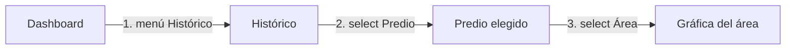
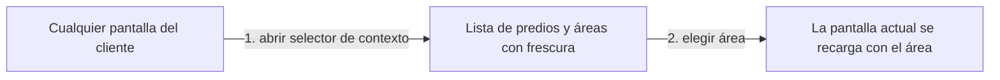
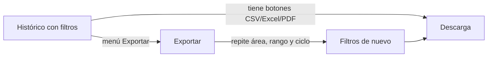
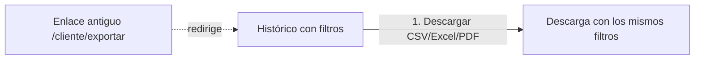
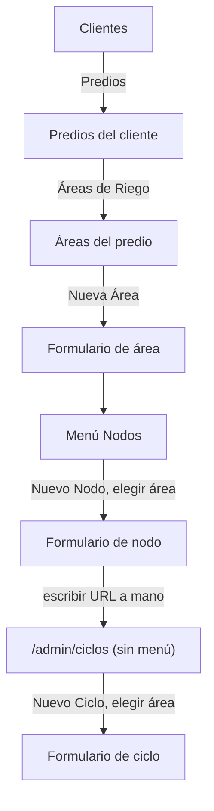
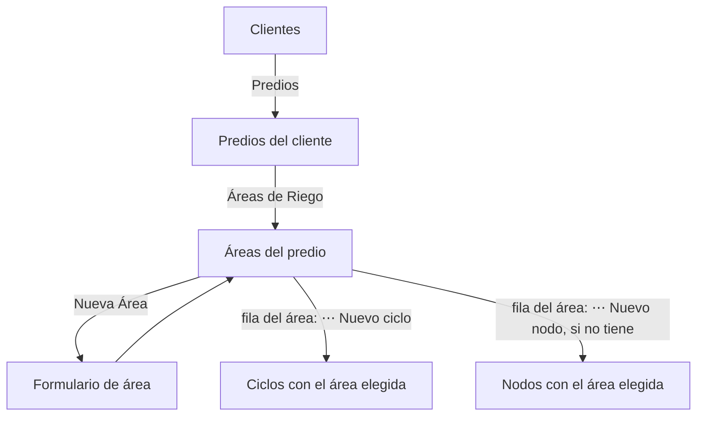
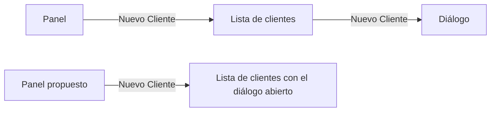

# Flujos de usuario: actuales y propuestos

Los conteos de acciones están **derivados** de la estructura de rutas y de los enlaces observados (no cronometrados). Una «acción» es un clic, una selección o una URL escrita. Ningún flujo propuesto añade funciones: reordenan accesos que ya existen.

## 1. Cliente: ver el histórico de otra área

**Actual** (3 acciones): menú «Histórico» → elegir predio en el `select` de la página → elegir área.

**Propuesto** (2 acciones, y el selector está en todas las pantallas): el selector de contexto del encabezado cambia el área sin salir de la pantalla.

## 2. Cliente: descargar datos

**Actual** (hasta 5 acciones desde el dashboard, derivado; dos lugares para lo mismo): menú «Exportar» → confirmar área → elegir rango → elegir ciclo → «Descargar CSV». El Histórico ya tiene los tres botones.

**Propuesto** (1 acción desde un histórico ya filtrado): la descarga vive en Histórico con los filtros activos; `/cliente/exportar` redirige allí y conserva los tres formatos.

## 3. Admin: dar de alta un área con su ciclo y su nodo

**Actual** (13 acciones contando cada «guardar», y una URL oculta): Clientes (1) → «Predios» (2) → «Áreas de Riego» (3) → «Nueva Área» (4) → guardar (5) → menú «Nodos» (6) → «Nuevo Nodo» (7) → elegir el área (8) → guardar (9) → escribir `/admin/ciclos` (10) → «Nuevo Ciclo» (11) → elegir el área otra vez (12) → guardar (13).

**Implementado** (12 acciones, sin URL oculta ni volver a buscar el área): Clientes (1) → «Predios» (2) → «Áreas de Riego» (3) → «Nueva Área» (4) → guardar (5) → «⋯» de la fila del área (6) → «Nuevo ciclo» (7, el diálogo abre con el área elegida) → guardar (8) → Atrás (9) → «⋯» (10) → «Nuevo nodo» (11) → guardar (12). Ganancia real: **un clic menos**, pero sobre todo ya no hay que conocer ni escribir `/admin/ciclos`, ni buscar de nuevo el área en dos selectores, y el área elegida no puede ser la equivocada. «Nuevo nodo» solo se ofrece si el área no tiene nodo (relación 1:1). «Ciclos» además tiene entrada de menú.

Requiere que `/admin/ciclos` y `/admin/nodos` lean un parámetro de consulta (`?area=ID&nuevo=1`), como ya hace Equipos con `?nuevo=1`. Es lógica de navegación, no de negocio; ver riesgos.

## 4. Admin: acciones rápidas del panel

**Actual** (2 acciones): «Nuevo Cliente» → lista de clientes → botón «Nuevo Cliente» de la lista.
**Propuesto** (1 acción): el atajo abre directamente el diálogo (`/admin/clientes?nuevo=1`).

## 5. Cierre de sesión en móvil

**Actual:** desplazar la barra inferior hasta el final (3 y 4 ítems ocultos) → «Salir». **Propuesto:** «Más» → «Salir» (2 acciones, siempre visibles).

## Flujos que no cambian

Login, emparejamiento de un equipo (`/pair` → aprobar), asistente de Equipos de 3 pasos, borrado con confirmación, cambio de tema. Funcionan y están cubiertos por pruebas e2e.

## Resumen

| Flujo | Antes | Después |
|---|---|---|
| Histórico de otra área | 3 | 2 (desde cualquier pantalla) |
| Descargar datos | hasta 5 | 1 desde Histórico |
| Alta de área + ciclo + nodo | 13 y una URL oculta | 12, sin URL oculta ni reselección del área |
| Atajo del panel | 2 | 1 |
| Cerrar sesión en móvil | desplazar y pulsar | 2 |
