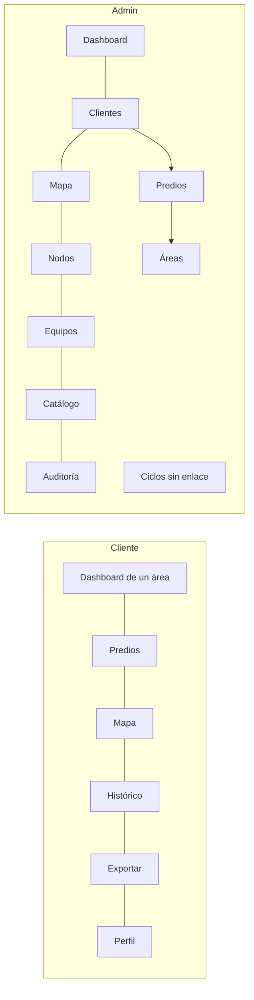
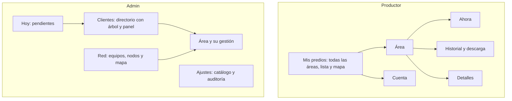

# Arquitectura de información y navegación

> Dirección aceptada por el usuario. **Validada con la auditoría y el prototipo (2026-10-31):** ningún dato la contradice. Cambios respecto de la propuesta original, marcados abajo como «Ajuste».

**Principio:** se navega por **cosas** (predio, área, cliente, equipo), no por **herramientas**. Cada cosa tiene dirección propia y sus herramientas viven dentro.

## Actual (`main`)

Problemas: portada de una sola área, selección oculta, funciones partidas por herramienta, jerarquía del admin en tablas anidadas, destinos ocultos en móvil.

## Propuesta

| Aspecto | `main` | v2 |
|---|---|---|
| Portada del productor | Un área | Todas las áreas |
| Destinos del admin | 7 planos + Ciclos oculto | 4 por trabajo: Hoy, Clientes, Red, Ajustes |
| Navegación | Barra lateral | Barra superior; pestañas inferiores en móvil |
| Contexto | Estado oculto | La URL, p. ej. `/cliente/area/12` |
| Mapa | Página aparte | **Página propia** (productor) y Red › Mapa (admin); la portada es un resumen con gráficas |
| Histórico y exportar | Dos páginas | Pestaña Historial del área |
| Ciclos y nodo | Otras secciones | Dentro del área |

## Clases de cambio

| Clase | Contenido | Autorización |
|---|---|---|
| **A. Reorganización** | Mis predios, Área, Directorio, Red, Ajustes: funciones existentes en otro lugar | Dirección aprobada |
| **B. Presentación nueva de datos existentes** | Grupo «Atención», bandeja Hoy, lista con varias áreas | Validar en el prototipo |
| **C. Requisito documentado sin pantalla** | Admin viendo lo que ve un cliente (`AGENTS.md` §3) | **Pendiente: solo con autorización** |
| **D. Excluido** | Búsqueda global, compartir áreas, anterior/siguiente | No implementar |

Una dirección por área es parte de la arquitectura, no una función de compartir: no se añade ningún botón ni flujo para ello.

## Validación (auditoría y prototipo)

| Supuesto | Resultado |
|---|---|
| «Portada de una sola área» | Confirmado (`/cliente` solo tiene 2 selectores) |
| «Destinos del admin: 7 planos + Ciclos oculto» | Confirmado; en móvil además 4 destinos quedan fuera de pantalla |
| «Ciclos sin enlace» | Confirmado (0 enlaces) |
| «Admin sin vista de cliente» (clase C) | Confirmado: `/cliente` como admin redirige a `/admin` |
| «Hoy: pendientes derivados de datos existentes» | Viable sin endpoints nuevos; el prototipo lo hace con 5 pendientes (sin comunicación, sin datos, sin nodo, sin ciclo, equipo por vincular) |
| Directorio sin cambiar de página para el alta | Viable en el prototipo; los campos escritos no disminuyen |

**Ajuste 1.** La estimación de pasos «13 acciones» en `main` era derivada; lo medido es **31 acciones y 6 pantallas** (`03-flujos.md`).
**Ajuste 2.** El pendiente «sin datos» (nodo que nunca reportó) no existía en la propuesta: se añade a Hoy, junto a «sin comunicación».
**Ajuste 3.** El panel de `main` tiene atajos que solo navegan («Nuevo cliente»); en v2 «Nuevo cliente» **abre el formulario** (clase A, mismo formulario).
**Ajuste 4.** Móvil del productor tiene solo 2 destinos (Mis predios y Cuenta), no 6: el área es una pantalla de segundo nivel. Con módulos de Fase 2 activos se añadirían desde Cuenta.

## Rutas

Cada ruta antigua redirige a la nueva. `/pair` y `/admin/gateways/pair` **no cambian** (contrato con la Raspberry). Las rutas de Fase 2 conservan su dirección.

| Antigua | Nueva |
|---|---|
| `/cliente` | Mis predios |
| `/cliente/areas` | `/cliente` (resumen con gráficas) |
| `/cliente/mapa` | `/cliente/mapa` (página propia de mapa) |
| `/cliente/predio/:id` | `/cliente` filtrado, con panel de predio |
| `/cliente/historico`, `/cliente/exportar` | `/cliente/area/:id/historial` del área activa; sin área, `/cliente` |
| `/cliente/perfil` | Cuenta |
| `/admin` | Hoy |
| `/admin/clientes/...`, `/admin/predios/:id/areas`, `/admin/ciclos` | Directorio |
| `/admin/nodos`, `/admin/mapa` | Red |
| `/admin/cultivos`, `/admin/auditoria` | Ajustes |

## Pantallas

**Mis predios.** Resumen («4 de 6 áreas reportando»), Lista o Mapa y filas densas agrupadas por predio con cultivo, humedad, flujo y frescura. En escritorio, lista y mapa juntos y sincronizados.

**«Atención» significa problema de datos, no necesidad de riego:** solo usa `no_data` y `stale`. Decir «falta agua» requeriría umbrales, que son Fase 2 bloqueada.

**Área.** Cabecera con migas, cultivo, ciclo y frescura, y pestañas:
- Ahora: humedad, flujo, E.T.O. y riego; gráfica; suelo, ambiente, clima y NDVI.
- Historial: filtros, gráfica, tabla y descarga.
- Detalles: cultivo, tamaño, ciclo, nodo y equipo.

**Hoy.** Lista de pendientes derivados de datos existentes, cada uno con enlace para resolverlo, y los totales. Conserva «Configurar Umbrales» y «Ver Auditoría» (`docs/ui-redesign-rules.md`).

**Directorio.** Árbol Cliente › Predio › Área y panel de la selección, con altas y ediciones ahí. Pestañas del área: Resumen, Ciclos, Nodo. En móvil, dos niveles con vuelta atrás.

**Red.** Equipos, Nodos y Mapa. **Ajustes.** Catálogo y Auditoría.

## Datos, sin endpoints nuevos

- `/nodes/geo`: área, predio, cultivo y frescura en una llamada. Umbral de 20 min, igual que `FRESH_MINUTES_THRESHOLD` (`backend/app/services/node.py`).
- Humedad y flujo: `/readings/latest` por área, patrón N+1 ya usado por `AreaSelector` (con `/readings`). Volver a pedir solo si cambia `last_reading_timestamp`.
- Las áreas sin nodo **no** vienen en `/nodes/geo`: combinar con `/irrigation-areas`.
- La URL sincroniza `SelectionContext`, para que las páginas de Fase 2 sigan funcionando sin tocarlas.
