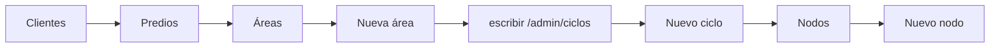
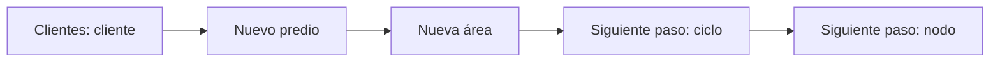
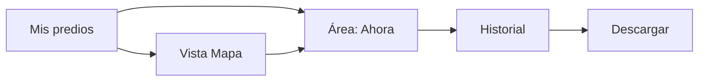

# Flujos de usuario

> `main` está **medido** (auditoría del 2026-10-31, `v2/audit/results/flow-*.json`). La columna v2 son los pasos que da el **prototipo** (`prototype/`), contados con el mismo método; las cifras de v2 son del prototipo, no de la app implementada.
>
> **Método:** cuenta cada acción del usuario: clic, campo escrito, selección y URL escrita a mano. Los pasos de «pantallas» son rutas distintas visitadas. Las cifras son iguales en 390 y 1366 px, salvo donde se indica.

## Resumen medido

| Tarea | `main` (medido) | v2 (prototipo) |
|---|---|---|
| Ver todas las áreas y si alguna dejó de reportar | Dashboard → Predios: **1 clic**. La lista muestra frescura por área (8 menciones de «Último dato» o «Sin reporte»), pero no distingue qué área tiene problema | **0 clics**: es la portada, con el grupo «Atención» arriba |
| Consultar otra área (productor) | **2 selecciones** para cambiar de predio y de área (1 si es del mismo predio), o **1 clic** en una tarjeta de Predios. La URL no cambia: sigue `/cliente` | **1 clic** en la fila; la URL es `#/area/:id` y se puede volver directo |
| Volver a un área concreta más tarde | **No es posible** por enlace: una sesión nueva abre otra área | Enlace directo al área |
| Histórico + CSV (con el área ya elegida) | Histórico → preset → CSV: **3 acciones** | Área → Historial → preset → Descargar: **3 acciones** desde el área (4 desde la portada) |
| Exportar + CSV | Exportar → Descargar CSV: **2 acciones** | Misma pestaña Historial (una sola página) |
| Alta cliente → predio → área → ciclo → nodo (admin) | **31 acciones** (14 clics, 13 campos, 3 selecciones, 1 URL manual), **6 pantallas**; Ciclos solo por URL | Ver «Alta de área» abajo |
| Saber qué está mal (admin) | **No se puede desde el panel**; hay que revisar Mapa o cada lista | **0 clics**: pantalla Hoy |
| Emparejar un equipo | `/pair` → aprobar | Igual (no cambia) |

Los 13 campos escritos del alta de `main` son 5 (cliente) + 1 (predio) + 2 (área; el tipo es selección) + 1 (ciclo) + 4 (nodo). **Los campos escritos no se pueden quitar**: son datos del dominio. Lo que v2 reduce son pantallas, saltos de menú y la URL manual.

## Productor (medido en `main`)

| Tarea | Pasos reales | Notas |
|---|---|---|
| Ver estado de todas las áreas | `/cliente` → clic «Predios» → `/cliente/areas` | Tarjetas por predio con humedad, estado y frescura; «Equipo pendiente» en las 4 áreas DEMO (correcto: equipo nunca conectado) |
| Consultar un área | En `/cliente`: elegir predio, elegir área | `/cliente` no tiene enlaces ni botones, solo 2 selectores |
| Consultar desde la lista | Predios → clic en la tarjeta del área | Navega a `/cliente` con esa área elegida (la selección vive en `SelectionContext` + `localStorage`) |
| Filtrar y descargar | Histórico → (área ya elegida) → preset «Últimos 30 días» → CSV | Descarga `export_<área>_<fecha>.csv` correctamente |
| Descargar por Exportar | Exportar → «Descargar CSV» | Mismo archivo; es otra página con los mismos filtros |
| Mapa | Mapa → selectores de predio y área | Muestra solo los nodos con GPS |
| Perfil | Perfil → «Editar Perfil» → nombre → «Guardar Cambios» | «Ver Planes» y «Cambiar Contraseña» no responden |

## Admin (medido en `main`)

| Tarea | Pasos reales | Notas |
|---|---|---|
| Alta completa | Clientes → Nuevo Cliente (5 campos) → Guardar → «Predios» del cliente → Nuevo Predio (1 campo) → Guardar → «Áreas de Riego» → Nueva Área (nombre, cultivo, tamaño) → Guardar → **escribir `/admin/ciclos`** → Nuevo Ciclo (área, inicio) → Guardar → Nodos → Nuevo Nodo (área, nombre, serie, lat, lon) → Crear | 31 acciones, 6 pantallas. Sin error de red en ninguna |
| Panel | Solo totales. «Nuevo Cliente» y «Nuevo Nodo» navegan sin abrir el formulario | Ningún pendiente listado |
| Asistente de equipo | Equipos → Nuevo equipo → «Paso 1 de 3: Rancho y áreas» | Solo se abrió el paso 1; ver límites en `01-auditoria.md` |
| Emparejar | `/pair?code=…` → `/admin/gateways/pair` | No se completó (requiere equipo real) |

## Alta de área

`main`:

v2:

En el prototipo el árbol se queda en pantalla, así que alta del predio, del área, del ciclo y del nodo ocurre **sin cambiar de página**: el panel muestra «Siguiente paso» calculado (sin ciclo → «Crear ciclo»; sin nodo → «Nuevo nodo»). Los campos a escribir son los mismos.

## Consulta del productor

## Casos de datos que cada flujo debe cubrir

El prototipo los representa y la implementación debe verificarlos:

| Estado | Cómo se distingue | Qué se muestra |
|---|---|---|
| Al día | Último dato ≤ 20 min | Valores y «hace N min» |
| Sin comunicación | Último dato > 20 min | Último valor conocido **atenuado**, aviso con fecha y tiempo, grupo «Atención» |
| Sin datos | Nodo sin ninguna lectura | Guiones (nunca 0) y explicación |
| Sin nodo | Área sin nodo asignado | Guiones y aviso de que lo registra el admin |
| Campo `null` (p. ej. potencial hídrico) | Valor ausente en la lectura | «—», nunca «0» |

El emparejamiento y el asistente de Equipos conservan su lógica; solo cambian de lugar y de aspecto.
